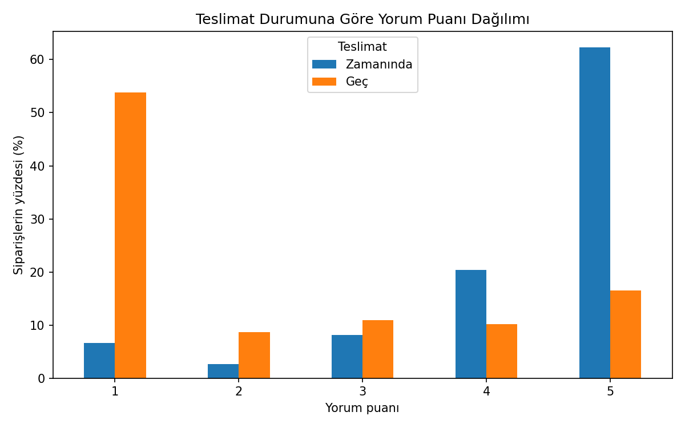
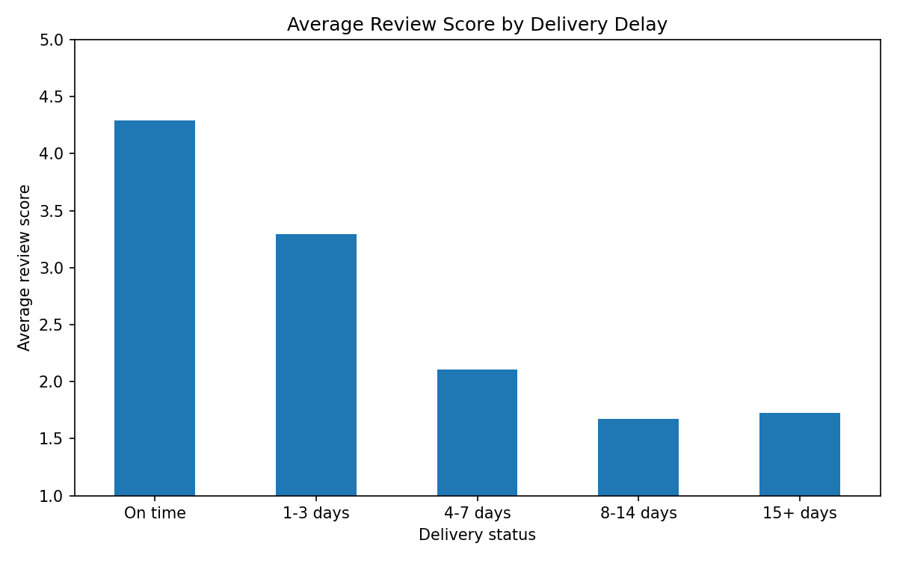

# Does Late Delivery Hurt Customer Satisfaction? An Olist Case Study

Analysis of how delivery delays relate to customer review scores, using the Brazilian e-commerce dataset from Olist.

## Question
Do orders delivered after the estimated delivery date receive lower review scores, and how large is the difference?

## Data
[Brazilian E-Commerce Public Dataset by Olist](https://www.kaggle.com/datasets/olistbr/brazilian-ecommerce) (Kaggle). The CSV files are not included in this repository. Download them and place them in a `data/` folder.

Tables used so far: `orders` and `order_reviews`.

## Method
- Delay (in days) = actual delivery date - estimated delivery date. An order counts as **late** if the delay is at least 1 full day.
- Only orders with status `delivered` and a valid delivery date were analyzed.
- Some orders had more than one review. The **most recent review** per order was kept.
- Orders without a review were excluded. For the regression models, orders with more than one seller or more than one product category (or no category information) were also excluded, leaving 93,086 orders.
- Groups were compared with a **Mann-Whitney U test**, because review scores are ordinal (1-5) and skewed. Effect size is reported as the rank-biserial correlation.
- For the seller analysis, orders containing items from more than one seller (about 1.3% of orders) were excluded.
- For the category analysis, orders containing more than one product category (about 0.7%) or no category information were excluded. Two category names missing from the translation file (`portateis_cozinha_e_preparadores_de_alimentos`, `pc_gamer`) were translated manually.
- Regression: OLS of review score on a late-delivery indicator, controlling for customer state and product category, with standard errors clustered by seller. A within-seller version (seller means subtracted) and an ordered logit model were used as robustness checks.

## Findings
- Mean review score: **4.29** for on-time orders vs **2.27** for late orders.
- 53.8% of late orders received a 1-star review, compared with 6.6% of on-time orders.
- The difference is statistically significant (Mann-Whitney U, p < 0.001) and the effect is large (rank-biserial r = -0.64).
- Scores drop as delays grow: 3.29 for 1-3 days late, 2.10 for 4-7 days, and about 1.7 beyond a week. The drop flattens after a week, partly because scores cannot go below 1.
- The gap is not explained by customer location alone: within each of the 12 states with at least 1,000 orders, late orders scored 1.6 to 2.3 points lower than on-time orders.
- The gap also holds within sellers: among the 285 sellers with at least 30 orders and at least 5 late orders, late orders scored lower than on-time orders for 284 of them (median gap -2.0 points).
- The gap also holds within product categories: in all 28 categories with at least 30 late orders, late orders scored lower (average gap -2.0 points, range -2.5 to -1.4).
- In regression models, late delivery is associated with a review score about 2 points lower (coefficient -2.01, 95% CI [-2.06, -1.96]) after controlling for state and product category. Within the same seller the estimate is almost identical (-2.00). An ordered logit model points the same way (odds ratio 0.07).

## Limitations
- This is an association, not proof of causation. Late orders may differ in other ways (distance, seller, product category) that also affect satisfaction.
- Reviews are voluntary, so customers who respond may not represent all customers.
- The seller comparison covers only larger sellers, so it may not generalize to small ones.
- The stratified comparisons (state, seller, category) each control for one factor at a time and only cover groups with enough orders.
- Model R-squared is about 0.17: delivery delay explains a meaningful part of review scores, but many other factors (product quality, expectations) are not measured.
- The ordered logit controls only for state and assumes the delay effect is the same at every score threshold; its confidence interval does not account for seller clustering.

## Next steps
- Build a SQL analysis of the full relational dataset.

## Tools
Python, pandas, matplotlib, SciPy